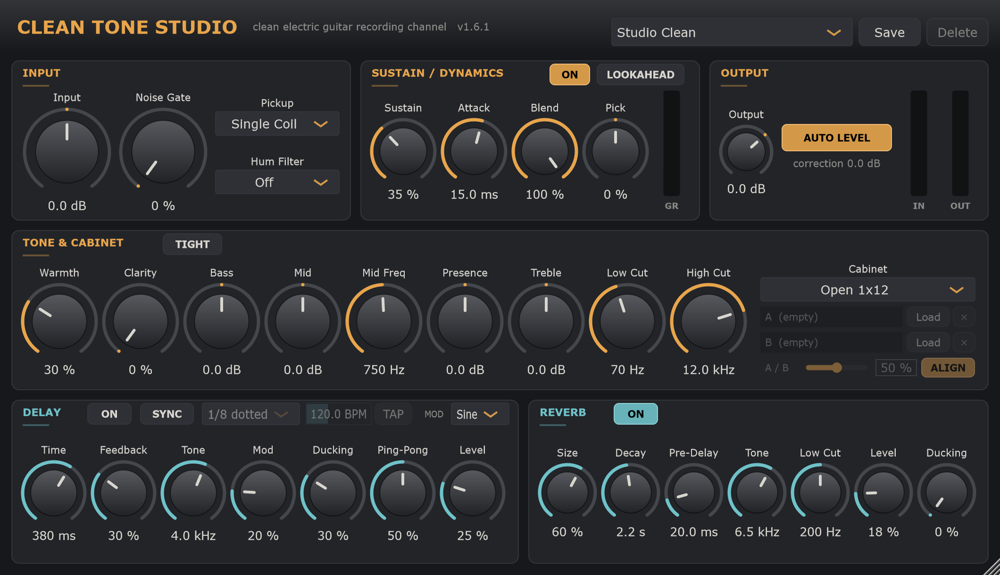

# Clean Tone Studio 1.6.1 (VST3 + standalone)

A channel strip for Windows for recording clean electric guitar: smooth and detailed, full-bodied, with plenty of sustain, a clean reverb and a smooth delay. Voicings are tuned for both single-coil and humbucker pickups.



## License: free software (GNU AGPLv3)

Clean Tone Studio is free software, released under the **GNU Affero General Public License version 3** (see [LICENSE.txt](LICENSE.txt)). Copyright (C) 2026 Al Oomens.

- **You may** use it for anything, including commercial recordings, and share it with anyone, for free or not.
- **If you share it**, pass on the license and offer the source code. The simplest way is to share the source zip (`CleanToneStudio-<version>-source.zip`) next to the program zip.
- **If you change it and share your version** (or run it for others over a network), your changes must be released under the same license.
- **There is no warranty.** See the license for the exact terms.

It is built with JUCE (AGPLv3) and the Steinberg VST3 and ASIO SDKs (both used under GPLv3); see [THIRD-PARTY-NOTICES.txt](THIRD-PARTY-NOTICES.txt). Click the **CLEAN TONE STUDIO** title in the app or plugin to see the license notice.

The source package contains everything needed to build: this folder plus JUCE 8.0.4 and the ASIO SDK under `external/`. Build with Visual Studio 2022 (Build Tools) and CMake, as described under [Building](#building). Unpack it to a short path such as `C:\src`: deep folders push the compiler's working files past Windows' 260-character path limit, and the build fails.

## What's new in 1.6.1

- **The name is Clean Tone Studio again.** 1.6.0 was released as "Open Clean Tone Studio". The rename had followed Open Mastering Studio's pattern, but the free-software license doesn't need it, so the original name is back. It's still free software under the GNU AGPLv3, with the same About box, notices and source zip.
- **Coming from 1.6.0:** presets saved in `Documents\Open Clean Tone Studio\Presets` are copied back to `Documents\Clean Tone Studio\Presets` the first time you open the plugin. It happens once, never replaces a preset that's already there, and leaves the 1.6.0 folder as it was (a new test checks all of this). `Install VST3.bat` removes `Open Clean Tone Studio.vst3`, so Cubase doesn't list the plugin twice. The app goes back to the sound card settings you had before 1.6.0.
- **Coming from 1.5.2 or earlier:** nothing to do; presets, projects and app settings are where they were.
- The plugin's VST3 IDs have never changed, so projects made with any version load it. The vendor shown in Cubase is "CleanTone Audio" again.
- No change to the sound. One compiler warning in the editor code, from a reused variable name, is fixed.

## What's new in 1.6.0

- **Released as free software under the GNU AGPLv3** (under the name "Open Clean Tone Studio", reverted in 1.6.1). The full source code, including JUCE and the ASIO SDK, ships as a separate source zip, and `Tools\package.ps1` builds both zips.
- **About box:** click the title to see the version, copyright, license and no-warranty notice.
- **The release zip** now has `Standalone\` and `VST3\` folders, `Install VST3.bat`, `Quick Start.txt`, the README, the measurements, the license and third-party notices.
- No change to the sound: every factory preset renders bit-for-bit as in 1.5.2.

## What's new in 1.5.2

- **TIGHT keeps very hot signals in check.** The Warmth curve also works as a soft limiter on very hot signals. Since 1.5.1, TIGHT sent the deep lows around it completely, so with a very hot input those lows came through unlimited: THE_LAB's extreme-settings test reached +14 dBFS (1.5.0: +2), and my replica reached +18.9 dBFS with Sustain at 100 %. In the standalone app that would clip your interface. The lows that bypass the curve now pass through a limiter that's exactly linear up to −6 dBFS (so TIGHT still adds no bloom at playing level) and eases into a 0 dBFS ceiling. Hot-input peaks with TIGHT are now within a few dB of TIGHT off, and this is a new test.
- THE_LAB's 1.5.1 pass also confirmed the TIGHT thump fix: the reverb-onset spur under a 10 kHz tone dropped from −67.8 to −77.7 dB.

## What's new in 1.5.1

- **TIGHT rebuilt.** In 1.5.0, TIGHT cut the lows 9 dB before the Warmth curve and boosted them 9 dB afterwards. The after-boost also raised the small low thump the curve makes when a bright note starts, by about 9 dB: THE_LAB's 1.5 pass showed it through the reverb, and my replica traced it to TIGHT. TIGHT now splits the band inside the oversampled stage, so the deep lows (below about 200 Hz) go around the curve untouched and nothing is boosted afterwards. It still removes about 8 dB of harmonics from low notes (−8.2 → −16.4 dB at Warmth 100 %), leaves high notes unchanged, and adds no thump of its own (0.0 dB against TIGHT off, now a test).
- The rest of that THE_LAB pass was clean. Its "aliasing on high notes" WARN is the reverb ringing out the start of the 10 kHz test tone: it fades to −115 dB within 4 s and is gone with the reverb off, as in 1.3 and 1.4.

## What's new in 1.5.0

Four controls for a clearer, more defined sound. All four are off by default, and every factory preset renders bit-for-bit as in 1.4.2:

- **Clarity** (Tone & Cabinet, next to Warmth) is a dynamic low-mid cut. It compares the muddy low mids (200–450 Hz) with the definition region (1–3 kHz). When the low mids pile up (chords, the neck pickup, a boomy cabinet or IR), it dips around 300 Hz, only as far and as long as needed. It sits after the cabinet, so it also tames boomy IRs. Measured at 100 %: a dark, muddy tone loses 4.7 dB of low mids, while a bright single-note tone loses only 1.5 dB and the 1–3 kHz region moves 0.5 dB or less. Unlike a fixed EQ cut, it doesn't thin out a tone that's already balanced.
- **Pick** (Sustain / Dynamics) is a transient shaper after the compressor. Turning it up brings the attack of each note forward for snap and definition; turning it down softens it for a rounder start. The body of the note is left exactly alone: at ±100 %, the attack moves by +3.6 / −2.8 dB while the ringing part of the note changes by 0.00 dB. It's handy for getting pick definition back after heavy Sustain.
- **TIGHT** (switch in the Tone & Cabinet header) keeps the deep lows out of the Warmth tube stage, so you get its harmonics without the low end blooming. With Warmth at 100 %, low notes get about 8 dB fewer harmonics (−8.2 → −16.4 dB, from 1.5.1) and high notes are unchanged. The lows themselves stay at full level.
- **Reverb Ducking** (Reverb section) makes the reverb back off while you play and bloom in the gaps, so it never washes over the notes. At 100 % the reverb drops 7.8 dB under your playing and is back within about 1 dB half a second after you stop.
- All four glide without clicks (the click scan now covers 234 control moves), give the same result at every buffer size, and are included in Auto Level. Presets set them like any other control; presets saved before 1.5 load with them off.
- The delay and reverb panels were rebalanced to make room for the reverb's Ducking knob.

## What's new in 1.4.2

- **Tempo for the delay's Sync, in the app and in a DAW.** A tempo display now sits next to the delay's Sync menu.
  - **In a DAW (VST3)**, Sync follows the project tempo as before. The display shows that tempo read-only (for example "128.0 BPM · host") so you can see what the repeats are locked to, and there is no TAP button, because the project tempo is in charge.
  - **In the standalone app**, there is no host tempo (previously Sync was stuck at 120 BPM). The display is now an editable **Tempo**: drag it, or double-click and type a value from 30 to 300 BPM. **TAP** sets it from your taps: it averages the last four, counts up on the button while you tap, and starts a new count after a 2-second pause.
  - If a host sends no tempo at all, the plugin uses its own Tempo too, instead of silently assuming 120.
  - Tempo is saved with the project. Presets leave it alone, like Output and Auto Level, since it belongs to your song rather than the sound. Changing it while the delay rings glides the repeats to the new time without a click.
- New tests: tap averaging and reset, the project tempo winning over the plugin's own Tempo in a DAW (identical to setting that Tempo by hand), the app using its own Tempo, the editor showing the right controls in each case, recall, presets leaving the Tempo alone, and a click-free tempo change.

## What's new in 1.4.1

From four THE_LAB passes on 1.4.0 (defaults, everything on, IR Loader, and the clean path), which passed Stress and Software with no faults:

- **IR Loader: new ALIGN switch (on by default).** It converts each impulse response to minimum phase when it's loaded. The frequency response stays exactly the same (within 0.001 dB), but the mic's lead-in before the main peak disappears, so the IR Loader adds no delay. Two IRs also blend without their low end cancelling. THE_LAB's IR pass found a 4-sample delay error and a "polarity inverted" reading, and the two IRs used there lost about 18 dB at 50 Hz in a 50/50 blend because a 20 ms IR and a 200 ms IR have very different low-frequency phase. On a similar test pair, the worst cancellation goes from −29.6 dB to −0.2 dB with ALIGN on. Turn ALIGN off to use IRs exactly as recorded. Projects and presets saved with IRs in 1.4.0 open with ALIGN off, so they sound as they did.
- **Auto Level matches the same at every sample rate.** Its reference phrase was synthesised at the running sample rate, so the synthetic string rang differently at 96 kHz, and the same settings got corrections up to 1.2 dB apart at 44.1, 48 and 96 kHz. That fits the 0.8 dB "sample rate drift" in THE_LAB's first two passes, which dropped to 0.24 dB in the pass with Auto Level off. The phrase is now always made at 48 kHz and resampled; the corrections now agree within 0.05 dB. At 48 kHz nothing changes.
- **Lower CPU, same sound.** Everything on (Ambient Swell) uses 3.1 % of one core at 48 kHz, down from 5.0 %. Warmth reuses half of its tube-curve math from the previous sample, and skips the curve entirely at 0 %. The reverb's 16 modulation LFOs use rotating phasors instead of `sin()`. The IR Loader only keeps its input history running while an IR is loaded. Renders are identical apart from the reverb's slow modulation, which moves the tail by less than −40 dB.
- New tests: ALIGN keeps the frequency response, removes the lead-in, and makes a 50/50 blend that never cancels. It adds no delay in the plugin, comes back with a project, and is off for 1.4.0 projects. Auto Level gives the same correction at 44.1 / 48 / 96 kHz. Two new analysis modes: `--iranalyze` for IR files and `--wavdiff` for comparing two renders.

## What's new in 1.4.0

Quality upgrades to five modules, plus a resizable window:

- **IR Loader.** A new Cabinet choice, **IR Loader**, plays your own speaker impulse responses: two slots (A and B) with an **A / B** blend, so you can mix two mics or two cabinets. It loads WAV, AIFF or FLAC files at any sample rate (stereo files are averaged to mono, and up to 0.3 s is used). Each IR is level-matched, so swapping cabinets doesn't jump in volume. Zero latency: the first part of the IR is a direct filter, and the rest is FFT convolution on a fixed internal block, so it sounds the same at every buffer size. Changing an IR while you play crossfades, and the new IR starts already "warm" (it has heard what you just played), so there's no gap or click. The IRs are saved inside your project and inside your own presets, so a session or preset opened on another PC has them too. The three built-in cabinets are still there.
- **Warmth is now a tube-style stage.** It is frequency-dependent: low notes are pushed harder into the curve than high ones, then put back to their original level, so it thickens the low end and leaves the top clear. It also has a **breathing bias**: the operating point shifts as you dig in, so the harmonics bloom with your picking instead of being a fixed color. The curve is anti-aliased (ADAA) on top of the 4× oversampling. At the default 30 % it adds about 3 dB more harmonics on low notes and is unchanged at 1 kHz.
- **Sustain compressor.** Its detector now ignores the lowest bass (a 100 Hz sidechain high-pass), so low notes and open E don't get squashed more than the rest. A two-stage, LA-2A-style release adds a slow "memory" after sustained playing on top of the existing program-dependent release: short notes recover quickly, long passages get a long, smooth tail that always finishes. The new **LOOKAHEAD** switch lets the compressor see each pick attack 3 ms early, so even the fastest transients are caught smoothly. It adds 3 ms of latency, which is reported to the host so Cubase compensates. Like the ON switch, presets leave it as you set it.
- **Reverb.** There are now 16 delay lines instead of 8, plus distinct **early reflections** that give the room a sense of size. **Decay** now means the real decay time: every line has a calibrated absorption filter, so the low end rings for exactly the time on the knob and the highs fade about four times faster, like a real room. Measured: Decay 1.0 / 2.5 / 6.0 s gives 0.95 / 2.45 / 5.67 s.
- **Delay modulation style.** Next to the delay's sync menu, **MOD** switches between **Sine** (the smooth, even sway from before) and **Tape**: a slow, irregular wow, a little flutter, and gentle tape-style softening of the repeats. Tape is deterministic, so it sounds the same on every playback and every bounce.
- **Resizable window.** Drag the corner (in Cubase too) and everything scales. In the standalone app the window also has a **maximize** button (or double-click the title bar), and it fills the screen.
- New tests, as `BehaviourTest` section 8: convolution against exact convolution (error −126 dB, zero latency, at 44.1 / 48 / 96 kHz), IR recall in projects and presets, older projects loading unchanged, no memory allocation and no clicks when IRs change while you play, reverb decay time, compressor sidechain and release, lookahead latency, Tape mode at every buffer size, and window scaling and maximize.
- Projects saved with earlier versions open with exactly the same settings, including the Cabinet choice.

## What's new in 1.3.0

From a second THE_LAB run on 1.2.0, which found the plugin's sound depended on what had been played through it earlier:

- **Auto Level depends on your settings only.** In 1.2.0 it kept learning the playing level, carried that over between runs, and re-learned during a render. So the same settings could sound different from one run to the next (THE_LAB: 8.5 dB "repeatability", 15 controls that "stay broken", a recall that "glided for 8.2 s"). It now measures every setting at a fixed, typical DI level (−25.5 dBFS RMS): the same settings always give the same sound. The **Input** knob still counts, because it changes how hard you drive the compressor.
- **Going back to a setting is instant.** Recent results are remembered, so returning to a sound you had moments ago snaps straight back (with a 150 ms glide) instead of re-measuring.
- **Controls that can't change the sound are ignored.** The delay's controls while the delay is off, and likewise for the reverb and compressor, never trigger a measurement.
- **CPU back down** to about 2 % of one core for everything on (1.2.0: up to 5 % while it kept re-learning).
- New tests use THE_LAB's own method: one copy, prepared between runs. They cover run-to-run identity, sounding the same after something much louder was played, and every control at 0 % and 100 % then back.

## What's new in 1.2.0
Fixes for everything a THE_LAB measurement run (Phil Speiser's plugin lab) flagged:

- **Auto Level is now deterministic.** It used to work on a background thread timed by the clock, so its correction landed at a slightly different moment depending on buffer size, render speed, CPU load and other copies of the plugin. That made bounces and reopened sessions sound slightly different, and could leave the level "stuck" after extreme settings. It now runs inside the audio callback in audio time: identical at every buffer size, two copies never disturb each other, and a reloaded session lands on exactly the same level.
- **No memory allocation on the audio thread** (previously about 70 per buffer, from parameter lookups). This removes a source of dropouts at small ASIO buffer sizes.
- **Every control returns exactly** after being pushed to an extreme. Glides used to stall a hair short of their target in floating point, which shifted reverb Size and Pre-Delay slightly for good.
- **Delay precision**: the echo read position is now computed in double precision. In float it was quantised to about 1/64 of a sample once the delay had been running a while, roughening the wow modulation.
- **Cleaner filters**: all EQ, cabinet and pickup filters run in double precision. In float the low-cut filters added a faint signal-dependent rumble (−76 dB). The worst spur below a loud 10 kHz tone drops from −75 dB to −109 dB.
- **The delay and reverb modulation keep running while they rest**, so switching them back on doesn't change the sound.
- New THE_LAB-replica tests guard all of this: allocation counting, buffer sizes with Auto Level learning, two copies side by side, same-copy recall, every control at 0 % and 100 %, stereo paths and the 10 kHz spur test.

## What's new in 1.1.0
- **No more clicks when you move controls.** Every knob glides and every switch crossfades, including Pickup, Cabinet, Hum Filter and the delay and reverb on/off switches. A scan of all 198 possible control moves while audio plays finds no clicks.
- **Projects and presets reload exactly.** A reopened project, or one where Cubase re-sends the program number after loading, now sounds bit-for-bit identical. Previously Cubase could reset tweaked knobs to the factory preset, and Auto Level could come back at a slightly different level.
- **New noise gate.** It has hold and hysteresis, so it no longer buzzes or stutters on low notes near the threshold at high settings, and it recovers fully afterwards.
- **Same sound at every buffer size** (bit-identical from 16 to 4096 samples at 44.1, 48 and 96 kHz).
- **Cleaner Warmth.** 4× oversampling (aliasing at the default setting drops from −42 to −77 dB), and **0 % is now truly clean**. The bottom 10 % of the knob fades the saturation in. The default (30 %) and every preset (15 % or more) sound the same as before.
- **Exact latency reporting.** The plugin measures its own delay (5 samples at 48 kHz, about 0.1 ms) and tells the host exactly.
- **THE_LAB-style measurements** of distortion, aliasing, frequency response, latency, silence and CPU: see [Reports/measurements.md](Reports/measurements.md).
- The version is shown in the plugin window, and in the file properties Windows and Cubase show.
## Install

The built plugin is at:

```
build\CleanToneStudio_artefacts\Release\VST3\Clean Tone Studio.vst3
```

Copy the whole `Clean Tone Studio.vst3` folder into `C:\Program Files\Common Files\VST3` (this needs admin rights), then rescan plugins in your DAW. From an **administrator** PowerShell:

```powershell
Copy-Item -Recurse -Force "C:\Code\CleanToneStudio\build\CleanToneStudio_artefacts\Release\VST3\Clean Tone Studio.vst3" "C:\Program Files\Common Files\VST3\"
```

## Standalone app (play through an ASIO sound card)

`build\CleanToneStudio_artefacts\Release\Standalone\Clean Tone Studio.exe` has the same sound, controls, presets and Auto Level as the plugin, and runs without a DAW. Its window can be resized or maximized, and the controls scale to fit. It's a single file, so you can copy it anywhere, e.g. your Desktop.

1. Install your sound card's ASIO driver and connect the card. Close other programs that use it, such as Cubase.
2. Open the app and click **Options → Audio/MIDI Settings…**
3. Set **Audio device type** to **ASIO**, and pick your sound card's driver as the device.
4. Under **Active input channels**, turn on only the input your guitar is plugged into. Choose your headphone or monitor **output** pair.
5. Set the **buffer size** to 64–128 samples for low latency, or raise it if you hear crackles. Use **Control Panel** to open the driver's own settings.
6. Untick **Mute audio input**. The app mutes input by default to avoid speaker feedback, which isn't a risk with a guitar and headphones. It remembers this.

The app folds your inputs to mono, so the guitar sits in the center with the stereo delay and reverb around it. It remembers your device, settings and last sound between sessions.

ASIO support uses Steinberg's ASIO SDK in `external\asiosdk` (included in the source package; offered under the Steinberg ASIO License or GPLv3, and used here under GPLv3). CMake turns ASIO on automatically when it finds `external\asiosdk\common\iasiodrv.h`.

To see which audio and ASIO drivers the app can find:

```powershell
.\build\PluginHostTest_artefacts\Release\PluginHostTest.exe --list-devices
```

Put it on a **mono** guitar track. It accepts mono and outputs stereo, so the delay and reverb come out in stereo. Stereo in/stereo out and mono in/mono out also work.

## Signal chain

`Input → Hum Filter → Noise Gate → Pickup Voicing → Sustain Compressor → Pick → Warmth (4× oversampled) → Tone EQ → Cabinet / IR Loader → Clarity → Delay → Reverb → Output`

| Section | Controls | What it does |
|---|---|---|
| **Input** | Input, Noise Gate, Pickup, Hum Filter | **Pickup** picks a corrective voicing and sets the level so both pickup types drive the compressor the same way. *Single Coil* adds low-mid body, softens the 3.3 kHz "ice-pick" and smooths the top end. *Humbucker* clears out mud around 320 Hz and opens up detail around 2.6 kHz and above 6 kHz. *Flat* leaves the signal unchanged. **Hum Filter** puts narrow notches on the 50 Hz or 60 Hz mains hum and its harmonics, which helps with single coils. **Noise Gate** keeps hiss down when Sustain is high. It opens instantly, holds for 35 ms and has 6 dB of hysteresis, so notes fading through the threshold close it once and smoothly, without buzzing or stuttering. |
| **Sustain / Dynamics** | ON, LOOKAHEAD, Sustain, Attack, Blend, Pick, GR meter | Smooth optical-style compressor with RMS detection through a 100 Hz sidechain high-pass (low notes don't over-compress), a soft knee and a two-stage release: it slows down the harder it compresses, and after sustained playing a slow "memory" stage lets go gently. **LOOKAHEAD** lets it see pick attacks 3 ms early (adds 3 ms latency, reported to the host). **Pick** brings each note's attack forward (+) or softens it (−) without touching the rest of the note. **Sustain** raises the compression and the automatic make-up gain together, so notes ring longer without a jump in volume. A longer **Attack** lets more of the pick attack through. **Blend** mixes in the uncompressed signal (parallel compression) for more detail. **ON** switches the compressor off when you already use a hardware compressor before your interface. It fades over about 50 ms, so it never clicks. Auto Level keeps the volume the same either way. Because it depends on your hardware rather than the sound, presets (factory and your own) leave it where you set it. |
| **Tone & Cabinet** | Warmth, TIGHT, Clarity, Bass, Mid, Mid Freq, Presence, Treble, Low Cut, High Cut, Cabinet, IR A / B, A / B blend, ALIGN | **Warmth** is a tube-style stage: mostly even-harmonic saturation for fullness, stronger on low notes than high ones, with a bias that breathes with your picking. It is 4× oversampled and anti-aliased, and level-matched at low levels. The bottom 10 % of the knob fades it in, so 0 % is completely clean. **TIGHT** keeps the deep lows out of it. **Clarity** trims the muddy low mids (around 300 Hz) only when they build up. **Cabinet** offers filter-based speaker voicings (Open 1x12, Classic 2x12, Closed 4x12), **IR Loader** for your own impulse responses (two slots with a blend, zero latency, saved with the project and your presets), or **Off (DI)**. **ALIGN** (on by default) makes each IR start at once and lets two IRs blend without the low end cancelling, keeping each IR's frequency response exactly. |
| **Delay** | On, Sync, division, Time, Feedback, Tone, Mod, Ducking, Ping-Pong, Level | Repeats get progressively darker. Changing the time makes the delay glide like tape instead of clicking; the glide speeds up and slows down smoothly and never bends the pitch more than 40 %. **Mod** adds subtle modulation, in one of two styles: **Sine** (a smooth, even sway) or **Tape** (slow irregular wow, flutter and gentle tape softening). **Ducking** pulls the repeats down while you play and lets them bloom when you stop. **Sync** follows the host tempo in a DAW (shown read-only next to the division menu). In the standalone app it uses the **Tempo** control, set by dragging, typing or **TAP**. |
| **Reverb** | On, Size, Decay, Pre-Delay, Tone, Low Cut, Level, Ducking | Early reflections followed by a diffuse network of 16 delay lines with slow modulation, so the tail is smooth and dense without metallic ringing. **Decay** is the measured decay time of the low end; above the **Tone** frequency it decays about four times faster. **Ducking** pulls the reverb back while you play and lets it bloom when you stop. **Low Cut** (200 Hz by default) keeps the low end of the reverb from getting muddy. |
| **Output** | Output, Auto Level, IN/OUT meters | **Auto Level** (on by default) keeps the output as loud as the input whenever you change presets or settings, so you can compare tones without louder automatically sounding better. The readout shows the correction it is applying. **Output** is the only control that changes the final level. Changing presets leaves Output and Auto Level where you set them. |

### How Auto Level works

Auto Level keeps a fixed reference clip: single notes followed by ringing, overlapping chord tones, at a typical DI level (−25.5 dBFS RMS, peaks around −12 dBFS). When the settings change and have been still for 50 ms, it renders that clip through a separate copy of the full signal chain. It compares K-weighted loudness (the weighting used by LUFS meters) before and after, and the output gain glides to the matching level.

The correction depends on the settings only, so the same settings always sound the same, in every bounce and every reopened project. It runs inside the audio callback in audio time and takes about half a second after you stop turning a knob, at any buffer size. While it measures it uses about 4× the plugin's normal CPU for that half second. Settings it has measured recently come back instantly. It never reacts to your playing, so it never fights the Sustain compressor or flattens your dynamics.

Because it matches at a typical DI level, set your interface so the guitar peaks around −12 dBFS (see the gain-staging tip). If you play much hotter or quieter, the compressor works harder or lighter than in the reference, and the match is a little less exact.
Measured result: with Auto Level off, the 8 presets span about 7 dB of loudness. With it on, they all fall within 1 dB, and big moves such as Bass ±12, Sustain 0→100, Input ±12, Reverb Level 100 or Cabinet off change the level by less than 1 dB. A reopened project starts at exactly the same level, sample for sample.

Double-click any knob to reset it.

### Smooth controls

Every control can be moved while you play without clicks or zipper noise. Gains and mixes glide with an S-shaped curve. Filter controls glide sample by sample. Pickup, Cabinet and Hum Filter crossfade over 30 ms. Delay and reverb fade in from silence when switched on. All of this runs on a fixed sample grid, so it sounds the same at any buffer size.
## Presets

Factory presets: Studio Clean · Glassy Single Coil · Warm Jazz Humbucker · Humbucker Chime · Funk Snap · Endless Sustain · Ambient Swell · DI Clean (No Cab)

### Your own presets

- **Save** (next to the preset menu) stores the current sound under a name you type. Press Enter to save or Esc to cancel. If the name already exists, the button changes to **Replace**, so you can't overwrite a preset by accident.
- Your presets appear in the preset menu under **My Presets**. "(edited)" after the name means knobs have moved since it was loaded. Pick the preset again to go back to it.
- **Delete** asks you to click again ("Sure?"), then moves the file to the Recycle Bin.
- Like factory presets, they never change **Output**, **Auto Level**, the delay's **Tempo**, or the compressor's **ON** and **LOOKAHEAD** switches.
- If the IR Loader has impulse responses loaded, they are saved inside the preset too.
- They're stored as `.ctpreset` files in `Documents\Clean Tone Studio\Presets`. The app and the VST3 share this folder, and an open window picks up presets saved elsewhere within about 2 seconds. Copy the folder to move presets to another PC.
- In Cubase, user presets live in the plugin's own menu. Cubase's program list only shows the factory presets. Cubase projects remember which preset was active.

## Gain-staging tip

Aim for DI peaks of about −12 dBFS at the interface; that's the level Auto Level matches at. If the GR meter shows constant heavy reduction, lower **Input**. Humbuckers are louder, and the Pickup setting already compensates for about 5 dB of that. With Auto Level on, **Input** changes how hard you drive the compressor and Warmth, not how loud the output is.

## Building

The version number lives in `CMakeLists.txt` (`project(... VERSION 1.6.1)`), and the product name next to it (`CTS_PRODUCT_NAME`); the plugin window, the saved settings and the Windows file properties all take them from there. The CMake target and the plugin codes stay `CleanToneStudio` / `Ctna` / `Ctgs`, so projects made with every version keep loading.

Requirements: Visual Studio 2022 (or Build Tools) and CMake 3.22+. JUCE 8.0.4 and the ASIO SDK are included under `external/`.

From the GitHub repository, JUCE comes in as a git submodule (pinned to 8.0.4), so clone with `--recursive`, or run `git submodule update --init` after a plain clone. The source zip on the Releases page already contains everything.

```powershell
cmake -S . -B build -G "Visual Studio 17 2022" -A x64
cmake --build build --config Release
```

To make the release zips (program and complete source) after a Release build:

```powershell
pwsh -File Tools\package.ps1
```

## Tests

`PluginHostTest` loads the built VST3 the way a DAW would. It renders a synthetic plucked-guitar signal (with a hot noise and hum floor) through every preset, then checks for NaN/Inf, clipping, level matching and tails that don't decay. It also checks that Auto Level keeps the presets and large setting changes at the same loudness. It also covers mono and stereo layouts, random block sizes, randomising every parameter on every block, extreme settings, the noise gate, saving and restoring state, and opening the editor.

```powershell
.\build\PluginHostTest_artefacts\Release\PluginHostTest.exe ".\build\CleanToneStudio_artefacts\Release\VST3\Clean Tone Studio.vst3" .\test-output
```

It writes a WAV file for each preset to `test-output\`.

`BehaviourTest` drives the plugin's processor directly, sample by sample, using the same approach as Mastering Studio's tests. It takes about 4 minutes:

1. **Clicks**: every control flipped between its extremes while a low sine plays. Any burst above 4 kHz must stay below −80 dB.
2. **Recall**: a reloaded project, a host re-sending the program number, restoring before or after the host prepares, a user preset loaded into a fresh instance, and every parameter value. All must be bit-identical.
3. **Noise gate**: no buzzing at any level around the threshold, one clean close as a note dies away, extreme settings, and full recovery afterwards.
4. **Buffer sizes**: 16 to 4096 samples, with and without Auto Level, must be bit-identical.
5. **Click scan**: all 234 parameter moves (every switch both ways, every choice to every other choice, every control) with every module running.
6. **Measurements**: latency exactness, gate transparency, neutral flatness, silence and CPU, with limits.
7. **THE_LAB replicas**: no memory allocation in `processBlock` (counted), buffer sizes 64 / uneven / 8192 / 0-sample with Auto Level on, two copies side by side, state loaded back into the same copy, one copy run twice and after much louder material, every continuous control at 0 % and 100 % then back on one copy, bit-identical stereo paths, and the 10 kHz high-note spur test.
8. **1.4 modules**: convolution versus exact convolution at 44.1 / 48 / 96 kHz; the IR Loader at different buffer sizes, in projects, presets and pre-1.4 projects; IR changes while playing (no allocation, no clicks); reverb decay time at low and high frequencies; compressor sidechain and two-stage release; lookahead latency; Tape modulation; Warmth's frequency dependence; and the window (opens at full size, scales, maximize button in the app). Since 1.4.1 and 1.5 it also covers ALIGN, Auto Level across sample rates, the delay Tempo and TAP, and Clarity, Pick, TIGHT and reverb Ducking each doing what they say.

Sections 2–4 run at 44.1, 48 and 96 kHz.

```powershell
.\build\BehaviourTest_artefacts\Release\BehaviourTest.exe                 # everything
.\build\BehaviourTest_artefacts\Release\BehaviourTest.exe --lab Reports\measurements.md
.\build\BehaviourTest_artefacts\Release\BehaviourTest.exe --clicks all     # click scan, every move listed
.\build\BehaviourTest_artefacts\Release\BehaviourTest.exe --snapshots <folder>
.\build\BehaviourTest_artefacts\Release\BehaviourTest.exe --bench          # CPU at 48 / 96 kHz
.\build\BehaviourTest_artefacts\Release\BehaviourTest.exe --stress         # THE_LAB replicas only
.\build\BehaviourTest_artefacts\Release\BehaviourTest.exe --spur           # 10 kHz high-note spur test
.\build\BehaviourTest_artefacts\Release\BehaviourTest.exe --modules        # 1.4 module checks only
.\build\BehaviourTest_artefacts\Release\BehaviourTest.exe --flips          # control flips (section 1) only
.\build\BehaviourTest_artefacts\Release\BehaviourTest.exe --alprobe        # Auto Level: compressor on vs off at several playing levels
.\build\BehaviourTest_artefacts\Release\BehaviourTest.exe --iranalyze a.wav b.wav   # IR files: lead-in, polarity, A / B / blend response, ALIGN
.\build\BehaviourTest_artefacts\Release\BehaviourTest.exe --wavdiff a.wav b.wav     # two renders: level and difference
```

## Measurements

`BehaviourTest --lab` measures what the plugin actually does, in the spirit of Phil Speiser's THE_LAB:

- **Harmonic distortion (THD)** at four levels and two frequencies (110 Hz and 1 kHz), for the neutral path, Warmth settings, the compressor, the gate and real presets.
- **Worst-case aliasing** from a 2–19 kHz sine sweep at −1 dBFS.
- **Frequency response** of each pickup voicing and cabinet.
- **Latency** reported to the host versus measured (impulse and cross-correlation, 44.1/48/96 kHz).
- **Silence in, silence out**, after a long reverb and delay tail.
- **Reverb decay**: the Decay knob against the measured RT60, below 300 Hz and above 2.5 kHz.
- **CPU per module**, plus the background cost of each Auto Level re-measure.

The latest results are in [Reports/measurements.md](Reports/measurements.md).

`PresetTest` exercises the user-preset system directly: save, load, overwrite, names Windows doesn't allow in file names, blank names, delete, corrupt files, two instances sharing the folder, and project save/restore. It uses a temporary folder.

```powershell
.\build\PresetTest_artefacts\Release\PresetTest.exe
```
